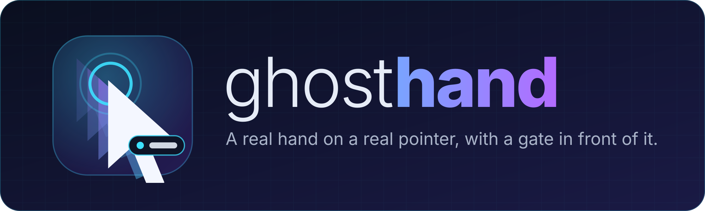
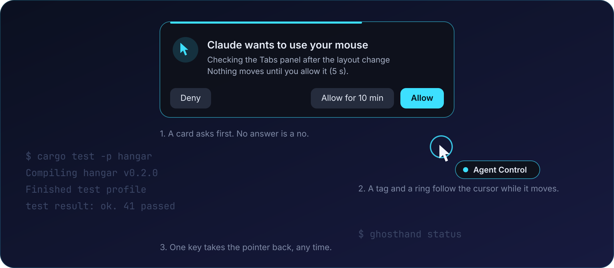

<p align="center">
  
</p>

<p align="center">
  <a href="CHANGELOG.md"></a>
  <a href="LICENSE"></a>
  
  
  
</p>

<p align="center"><b>Digital Food for the Analog Soul</b><br>by <a href="https://cloudwerxlab.com">CLOUDWERX LAB</a></p>

---

Ghosthand lets a coding agent use your real mouse pointer on a Wayland desktop. Right click a menu, drag something, hover a tooltip, scroll a list, then take a screenshot and see what happened. It was built for niri on Arch and CachyOS, because that's what I run, and it works there really well.

The part I care about most is the gate. Before anything moves, a card shows up on your screen saying who's asking and why. Nothing happens until you click Allow. No answer counts as a no. While the agent is driving, a little "Agent Control" tag and a ring follow the cursor so you always know it's not you. One key takes the pointer back at any time.

<p align="center">
  <br>
  <sub>An illustration of the card and the tag, not a screenshot of a real desktop.</sub>
</p>

## Why it exists

I got tired of agents that could write a whole UI but couldn't open a right-click menu on it. Screenshots tell you what's there. They can't tell you what happens when you hover or drag. So the agent has to be able to use the pointer, and I had to be able to trust that it only does that when I say so.

How it works under the hood is simple. Ghosthand creates a virtual absolute pointer through `/dev/uinput`, so the compositor sees it as a normal mouse. No portals, no compositor plugins, no X11. The overlay is a small Quickshell config. Everything else is plain Python with no dependencies.

## What you get

- **A real pointer.** Click, double click, right click, middle click, drag, right drag, scroll both ways, hover.
- **A gate.** Allow, Allow for N minutes, or Deny, on a card with a countdown. Silence is a no.
- **A visible tag and ring** that follow the cursor while an agent drives it.
- **A panic key.** `ghosthand revoke` stops a running agent, ends any grant and closes the card. Bind it to a key.
- **Screen coordinates that match screenshots.** You give it pixels from a `grim` screenshot and it handles the scale.
- **An MCP server**, so Claude Code, Codex and anything else that speaks MCP can use it. There's no tool to approve a request. That part's yours.
- **A lock check.** It refuses to run while your session is locked, and if it can't tell, it counts as locked.
- **No Python dependencies.** Standard library only.

## Install

You need Python 3.9 or newer, [Quickshell](https://quickshell.org), `grim`, and a Wayland compositor. niri is the one I test on. Other compositors should work (see [the notes](docs/other-compositors.md)) but I haven't run them myself.

```sh
git clone https://github.com/CLOUDWERX-DEV/ghosthand
cd ghosthand
pip install --user .        # or: pipx install .
ghosthand setup             # puts the overlay in ~/.config/quickshell/ghosthand
```

Then give your user access to `/dev/uinput`. This is the one step that needs root, once:

```sh
sudo cp packaging/99-ghosthand-uinput.rules /etc/udev/rules.d/
sudo udevadm control --reload && sudo udevadm trigger /dev/uinput
sudo usermod -aG input "$USER"      # log out and back in
```

Start the overlay and check everything:

```sh
ghosthand overlay &         # or autostart it, see docs/setup.md
ghosthand doctor
```

On Arch there's a [PKGBUILD](packaging/PKGBUILD) too.

## Use it

Each action is one quoted argument. Coordinates are pixels in a `grim` screenshot.

```sh
ghosthand --who Claude --reason "Checking the bar menu" \
  'jump 800 26' 'wait 0.4' 'rclick' 'wait 0.8' 'shot /tmp/menu.png'
```

| Action | What it does |
| --- | --- |
| `jump X Y` | put the pointer there at once |
| `move X Y` | glide there in small steps, so hover states follow |
| `click` `dclick` `rclick` `mclick` `[X Y]` | click where it is, or at X Y |
| `down` `up` `rdown` `rup` | hold and release a button |
| `drag X1 Y1 X2 Y2` | press, glide, release (`rdrag` uses the right button) |
| `scroll N [X Y]` `hscroll N [X Y]` | wheel notches, positive scrolls the content down |
| `wait SECONDS` | sleep for animations (a revoke still stops it) |
| `shot FILE [X Y W H]` | screenshot of the output or a region |
| `pos` `info` | where the pointer is, and the output's size and scale |

Typos are caught before anything moves, so a bad action can't leave you half way through a drag. If something goes wrong or you revoke, held buttons are released.

Exit codes: `0` done, `1` an action failed or the session is locked, `2` bad usage, `3` taken back, `4` denied or no answer, `5` the overlay can't be reached.

### Use it from an agent over MCP

```json
{
  "mcpServers": {
    "ghosthand": { "command": "ghosthand", "args": ["mcp"] }
  }
}
```

Claude Code: `claude mcp add ghosthand -- ghosthand mcp`

The tools are `pointer`, `screenshot`, `screen_info` and `gate_status`. `pointer` needs a `reason`, because that's what you read on the card. `screenshot` doesn't need approval since it never touches the pointer. [More in the docs.](docs/mcp.md)

### Bind the panic key

For niri, add this to your config (the full snippet is in [`packaging/niri-snippet.kdl`](packaging/niri-snippet.kdl)):

```kdl
binds {
    Mod+Ctrl+Alt+Escape allow-inhibiting=false { spawn "ghosthand" "revoke"; }
}
```

## Config

`~/.config/ghosthand/config.json`, read by the overlay, and only by the overlay. A program asking for the pointer can't change any of it.

```json
{
  "mode": "ask",
  "countdown": 8,
  "grant_minutes": 10,
  "accent": "#3de0ff"
}
```

- `mode`: `ask` (must be allowed, default), `notify` (a countdown that goes ahead unless you deny) or `off` (no card, the tag still shows).
- `countdown`: seconds the card waits, 2 to 60. An agent can ask for longer, never shorter.
- `grant_minutes`: what "Allow for N min" grants, 1 to 240.
- `accent`, `ui_scale`: the look.

More in [docs/configuration.md](docs/configuration.md).

## How it compares

There are other tools doing nearby things, and some are very good. I'm not going to claim I beat them at anything, because I haven't benchmarked it. Here's the honest version of how they differ:

- [**Cua Drivers**](https://github.com/trycua/cua) is a big, polished project that covers sandboxes, VMs and more across platforms. If you want that scope, use it. Ghosthand is much smaller and only does the local pointer on Wayland.
- [**computer-use-linux**](https://github.com/agent-sh/computer-use-linux), [**Deskwright**](https://github.com/tristanmuzzu/deskwright) and **hypruse** also give agents a desktop to drive. If you're on Hyprland or want accessibility trees or window control, look at those first.

What Ghosthand focuses on is the human side of it: a gate you answer, a tag you can't miss, and a key that takes everything back. And it's built around niri on Arch/CachyOS, where I got tired of nothing quite fitting.

## Limits, said plainly

- **It isn't a security boundary.** It's a courtesy gate. An agent with a shell and write access to `/dev/uinput` can skip Ghosthand and make its own pointer. The gate protects you from an agent that's behaving, not one that's hostile. If you need a hard boundary, run the agent somewhere that doesn't have `/dev/uinput`. Read [SECURITY.md](SECURITY.md).
- **No keyboard yet.** Pointer and screenshots only for now.
- **The overlay needs Quickshell.** Other compositors work for the pointer part, but the card and tag need a layer-shell overlay.
- **The scale comes from niri.** On other compositors set `GHOSTHAND_OUTPUT_SIZE` and `GHOSTHAND_SCALE`.

## Develop

```sh
python -m unittest discover -s tests -t . -v
```

Tests use a fake pointer, so they run anywhere, no uinput needed. See [CONTRIBUTING.md](CONTRIBUTING.md).

## Support

If it's useful to you, you can [buy me a coffee](https://buymeacoffee.com/cloudwerxl3). More from us at [cloudwerxlab.com](https://cloudwerxlab.com) and [github.com/CLOUDWERX-DEV](https://github.com/CLOUDWERX-DEV).

MIT licensed. See [LICENSE](LICENSE).
